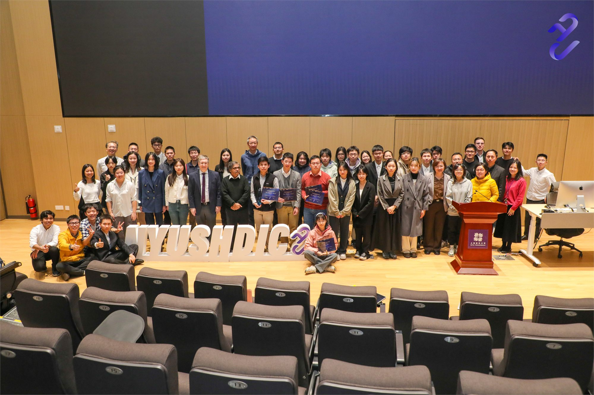

You're viewing an archived page from **DIC 2023**. [← Back to Past Events](/PastEvents/) · [See DIC 2026 →](/DIC2026/)
{: .notice}

NYUSH Digital Innovation Challenge, also known as NYUSHDIC, is a project-oriented innovation competition where participants apply media technology to solve real-world business problems.

We are composed of an annual big competition every fall, a lot of tutorial workshops, and some creative small events each year.

Here is a report you can see about NYUSHDIC 2023 from NYUSH official website.

[Students Showcase Creativity and Business Acumen in Digital Innovation Challenge](https://shanghai.nyu.edu/news/students-showcase-creativity-and-business-acumen-digital-innovation-challenge)